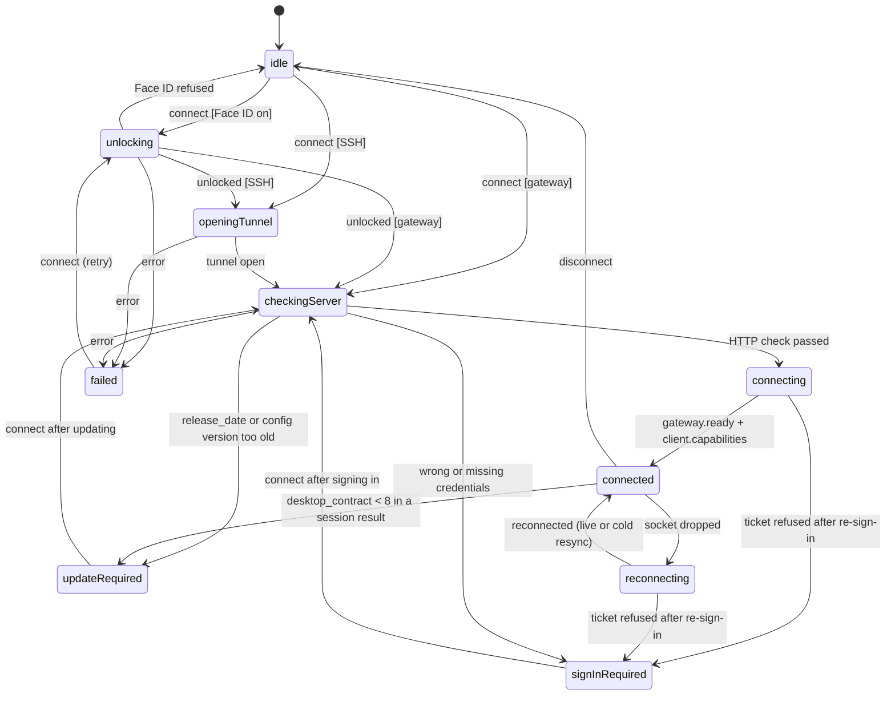

# Architecture

Source of truth: `plans/hermes-iphone-plan.md` section 3 (kept in the project files; summarized here).

## Modules (Swift packages in one repo)

- `HermesKit` — pure Swift, Linux-buildable, no UIKit, no Combine: models, transport abstraction, JSON-RPC client, REST client, auth, event reducer, connection manager.
- `HermesSSH` — Citadel/SwiftNIO SSH: session, exec, loopback forwarder. Linux-buildable.
- `HermesUI` — SwiftUI design system and feature views.
- `App/` — app target, widgets, intents, Live Activity, Share extension.

## Transport abstraction

A `HermesEndpoint` value (base URL with optional path prefix, extra headers such as `Host`) is produced by both gateway and SSH modes. REST and WebSocket code run on `URLSession` identically for both.

## Concurrency and UI

Structured concurrency; one `actor` per connection; events as `AsyncStream`; `@Observable` view models on the main actor. Streaming deltas are coalesced into frame-sized batches; markdown parses the tail block only.

## Transcript reducer

`TranscriptState.apply(_:)` (`Sources/HermesKit/Transcript/`) is a pure reducer: gateway events, attach results and the user's own actions (submit, answer) in, chat rows out. One state per open session; events for other live ids and duplicate `seq` values are dropped. A turn with tool calls becomes one assistant segment per stretch of text, with the tool rows between them. Feed it with `TranscriptAction(clientEvent)`: a live re-attach maps to nothing (the replay already filled the gap), a cold one rebuilds from the attach result. `apply(contentsOf:)` merges delta bursts first, with the same result as one at a time.

## Persistence and secrets

GRDB (async/observation APIs only) in an App Group container (`group.com.simplyjaytea.simplyhermes`). Keychain (`kSecAttrAccessibleAfterFirstUnlockThisDeviceOnly`) in the shared access group `$(AppIdentifierPrefix)com.simplyjaytea.simplyhermes.shared`.

Connections (WP-22): `ServerConnection` values (no secrets) are saved by `ConnectionStore` as JSON until GRDB lands.
Secrets go through `CredentialStore`: `KeychainCredentialStore` in the app, keyed `<connection id>/<kind>` (gateway
password only when "Remember password" is on, session token, SSH key as `StoredSSHKey` JSON). It uses the app's
default access group for now; the shared group needs its team prefix read at runtime on a sideloaded build. Face ID
(`deviceOwnerAuthentication`) gates reading an SSH connection's secrets; on by default for SSH, optional for gateways.

## Gateway sign-in (WP-13)

`SignInOptions.detect` reads `/api/status` (`auth_required`, `auth_flows`) and `/api/auth/providers`. The form offers
only what the server supports: Browser for OAuth/OIDC providers or `native_pkce`, Password for `basic`, Token always.

- Browser, native (RFC 8252 + PKCE): `ASWebAuthenticationSession` opens `/auth/native/authorize` with an ephemeral
  session; `LoopbackRedirectReceiver` catches `http://127.0.0.1:<port>/cb`; the code is redeemed at
  `/auth/native/token`. If the sheet or the listener cannot start, a `WKWebView` runs the same flow and stops at the
  loopback redirect. Tokens are stored as `nativeTokens` JSON in the Keychain.
- Browser, cookie fallback (no `native_pkce`): a non-persistent `WKWebView` signs in at `/auth/login` and its gateway
  cookies are stored as `webCookies`.
- `GatewayAuthSession` (one actor per connection) owns the REST client's auth: bearer tokens refreshed
  `/auth/native/refresh` before expiry (one refresh at a time; a refused refresh deletes the tokens and asks the user
  to sign in again), the 401 hook, silent password re-login (at most once a minute, only with "Remember password"),
  and WebSocket tickets for the gateway client.
- CI: `NativeAuthLiveTests` (basic provider) and `OIDCSignInLiveTests` (Dex, `up.sh --profile oidc`, port 9120) run
  the whole flow on Linux against the testbed, with a scripted browser in place of the sheet.

## Connection registry and lifecycle (WP-15)

`SavedConnections` holds the registry: names unique ignoring case (at most 64 characters), dedupe by normalized URL
(gateways) or `user@host:port` plus remote profile (SSH), a primary connection (the first one added, starred in the
Servers list), and Open on launch (Primary or Last used, as in Hermes Desktop; "last used" is the last connection
that connected).

`ConnectionManager` connects on demand: `client(for:)` runs the steps below once and hands every caller the same
`GatewayClient`. `ConnectionLifecycle` is the pure state machine it runs; `StandardConnectionDriver` (HermesSSH)
does the work (Face ID, Keychain, SSH tunnel with the pinned host key, `GatewayAuthSession`). Results from an attempt
that was disconnected are dropped; a tunnel that opens after its attempt ended is closed.

Every phase goes to `idle` on disconnect, stopping the socket and closing the tunnel. Compatibility never reads
`version`: `/api/status` gives `release_date` (minimum `2026.9.24`) and `latest_config_version` (minimum 50); the
first `session.create` or `session.activate` gives `info.desktop_contract` (8; higher connects with an "update
simplyHermes" note). The Test button runs the same HTTP check plus a WebSocket leg: open `/api/ws` with a fresh
ticket (SSH: the tunnel token), wait for the handshake, call `gateway.capabilities`.

## Downloaded on-device models (WP-65c)

Plan Q17: the Apple on-device model is the default, and the user can also download an MLX model. Plan Q45: the list is
Settings > On-device models, also opened from "Get a better model" in offline chat.

- `HermesKit/OnDeviceModels`: the catalog (three models pinned to a Hugging Face commit, with exact file names and
  sizes, so the size shows before a download), the download manager (one download at a time, file by file into
  `<id>.partial`, pause and resume with URLSession resume data, a free-space check first), the storage under
  Application Support/simplyHermes/OnDeviceModels (excluded from backup), and `OnDeviceModelSelection`. The selection
  is itself a `LocalModelExecutor`: it answers with the Apple model unless the user picked a downloaded model, and
  falls back to Apple after a memory warning, when the files are gone, or when the device cannot run the model. The
  model runtime is a protocol (`OnDeviceModelRuntime`), so HermesKit never imports MLX and the logic is tested on Linux
  with mocks.
- `App/HermesApp/OnDeviceModels`: the MLX side. `MLXLanguageModel` (mlx-swift-lm, product `MLXFoundationModels`, iOS 27)
  runs the model folder, a small tokenizer bridge uses swift-transformers, and `OnDeviceModelServices` wires it up and
  listens for `UIApplication.didReceiveMemoryWarningNotification`. The MLX packages are declared in `project.yml`, not
  in `Package.swift`, so Linux CI does not fetch them. The Simulator has no runtime: the Apple model answers there.
- `HermesUI/OnDeviceModels`: `OnDeviceModelsView` (the switch for on-device features is a `Binding<Bool>` from the
  caller), its model, and the `onDeviceModels` environment value.
- The app asks for `com.apple.developer.kernel.increased-memory-limit` (`project.yml`). See `docs/sideloading.md`.

## Networking permissions

LAN gateways need `NSLocalNetworkUsageDescription` (set); the app explains the prompt once before the first Test of a
private-network host. ATS: iOS 10 and later ignore `NSAllowsArbitraryLoads` when `NSAllowsLocalNetworking` is set.
Local networking covers IP addresses (including Tailscale `100.x`), single-label names and `.local`. `*.ts.net` has its
own `NSExceptionDomains` entry that allows plain HTTP; without it, `http://` to a MagicDNS name fails on the phone while
Safari loads it. `.lan`, `.internal` and `.home.arpa` have no exception yet, so `http://` to them is still blocked by
ATS. The app enforces plan Q14 itself (`ConnectionAddress`): `http://` only for loopback, private and Tailscale hosts,
with a warning; HTTPS everywhere else. A bare `*.ts.net` name without a port defaults to `https://`, the
`tailscale serve` address.

## Project file

XcodeGen `project.yml`; the `.xcodeproj` is generated and git-ignored.

## Build and CI

- Linux job: format lint, `swift build`, `swift test` (container `swift:6.1`).
- macOS job: runner label `xcode-27`, Xcode 27.1, `swiftlint`, `xcodegen`, `xcodebuild test` on the Duo simulator if present, else the newest iPhone simulator.
- Swift in the cloud dev container: install the Linux toolchain from download.swift.org (6.1.2 works for `HermesKit`/`HermesSSH`); no setup script is committed.
